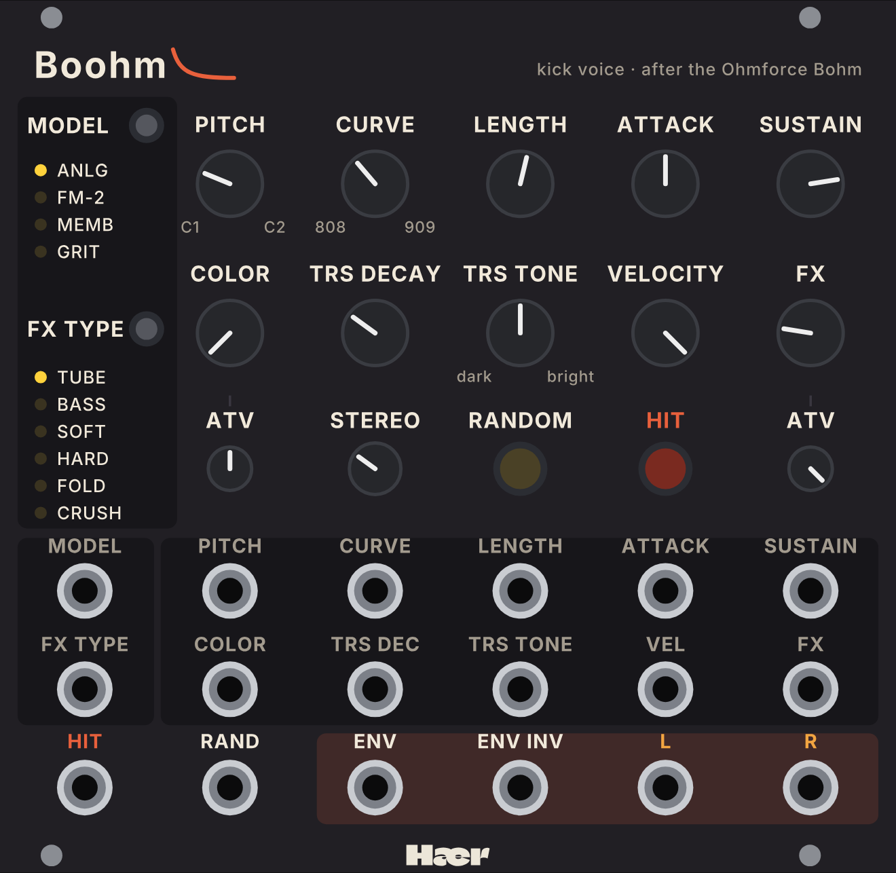

# Boohm

A stereo kick drum voice for VCV Rack, by Haer. It's built as a companion to
the **Ohmforce Bohm** Eurorack kick module: the controls follow the Bohm's
panel (HIT, VELOCITY, LENGTH, SUSTAIN, ATTACK, PITCH, CURVE, COLOR, TRS DECAY,
TRS TONE, FX, STEREO), so ideas move easily between the hardware and Rack.
The sound engines, DSP and panel are original. Boohm isn't affiliated with or
endorsed by Ohm Force, and it doesn't reproduce their models or wavetables.

## Controls

| Control | What it does |
|---|---|
| **HIT** (button + jack) | Plays the kick. A short trigger plays the whole kick. If you hold the gate high, the body sustains until you let go (you can switch this off in the right-click menu). |
| **PITCH** | Base note, C1 to C2. The ATV below it scales the PITCH CV. With ±5 V and the ATV fully up, the CV moves the pitch ±1 octave. |
| **CURVE** | Shape of the pitch drop. Left gives the fast, snappy 808-style drop. Right gives the slower 909-style sweep. |
| **LENGTH** | Total length of the kick, from 40 ms to 2.5 s. |
| **ATTACK** | Click level plus a punch boost in the first ~20 ms. It's FM depth on FM-2 and beater level on MEMB. |
| **SUSTAIN** | Body level. It's the room-mic level on MEMB. The ATV below it scales its CV. |
| **COLOR** | Body timbre (see the models below). |
| **TRS DECAY / TRS TONE** | Click length (1 to 150 ms) and click tone (dark to bright). |
| **VELOCITY** | Output level. The VEL jack sets the level of each hit when it's played (10 V = full). |
| **FX / FX TYPE** | Drive amount, and its type: TUBE, BASS (lows only), SOFT, HARD, FOLD, CRUSH. |
| **STEREO** | Width of the click, harmonics and room. The sub stays mono. |
| **RANDOM** (button + jack) | Picks a new sound. It keeps the model and velocity unless you tick *RANDOM also changes the model* in the right-click menu. |
| **ENV / ENV INV** | The kick's body envelope, 0 to 10 V, and its inverse (10 V falling to 0). Use ENV INV on a VCA for sidechain-style ducking. |
| **L / R** | Audio out. If only L is patched, it carries a mono mix. |

Every main knob also has a CV jack. The CV adds to the knob, and 10 V sweeps the whole range.

## Models

- **ANLG**: analogue-style body. COLOR morphs sine → triangle → warm saturated → squarish. Noise-and-tick click.
- **FM-2**: two-operator FM. ATTACK = FM depth, TRS DECAY = FM decay (10–100 ms), TRS TONE picks one of 8 modulator waves, COLOR = carrier (sine → triangle → square). Set the ratio in the right-click menu (0.5–15, default 2).
- **MEMB**: a struck drum head (8 modes) played by a beater, heard through a small room. PITCH = head size, CURVE = how far the head bends in pitch after the hit, LENGTH = head damping, ATTACK = beater click, TRS TONE = beater hardness, COLOR = shell overtones, SUSTAIN = room mic level, TRS DECAY = room size, STEREO = room width.
- **GRIT**: eight digital single-cycle tables, scanned by COLOR, with a metallic FM tick on top of the click.

## Right-click options
- Model and FX type pickers
- FM-2 ratio
- PITCH CV tracks 1 V/oct. The PITCH knob becomes an offset above C1, and the ATV is ignored.
- Held HIT sustains the kick (on by default)
- RANDOM also changes the model

## Building
`make dist RACK_DIR=<Rack-SDK>` builds the plugin. GitHub Actions builds the mac-arm64 version on every push.
`test/render.cpp` renders test kicks to WAV files without Rack:
`g++ -O2 -std=c++17 test/render.cpp -o test/render && ./test/render out/`.
The panel is generated by `python3 res/make_panel.py`.
